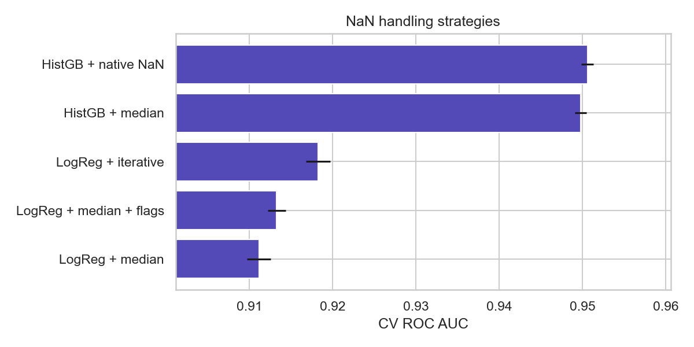
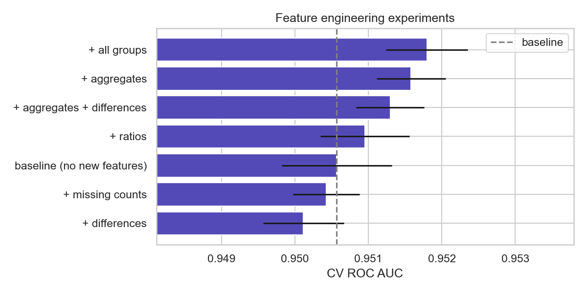

# Predicting Phone Addiction from Usage Habits (Kaggle)

A machine learning project built to refresh my ML skills end to end: exploratory analysis, missing-value handling, feature engineering, model comparison, tuning, and a Kaggle submission.

**Final result: ROC AUC = 0.96354** (public and private leaderboard, identical).

> **Note:** the dataset looks synthetic (clean value ranges, no impossible values), and this model is a learning exercise. It is **not** a medical or diagnostic tool.

## Problem

Given 12 features about a person's phone usage and lifestyle, predict whether they are labeled as addicted to their phone (`addicted_label`: 1 = addicted).

- **Competition:** [text](https://www.kaggle.com/competitions/playground-series-s6e8/overview)
- **Metric:** ROC AUC (so the submission contains probabilities, not 0/1 labels)
- **Training data:** 691,369 rows, 14 columns (the raw data is not included in this repo, see the competition page)
- **Target balance:** about 71% positive, 29% negative

## Approach

| Step | What I did | Why |
|---|---|---|
| 1. EDA | Target balance, distributions, correlations, single-feature AUC, missingness patterns | Understand the signal before modeling |
| 2. Missing values | Compared median imputation, missing flags, iterative imputation, and native NaN handling in tree models | Most features had 4% to 19% missing values; dropping rows was not an option |
| 3. Feature engineering | Tested groups of new features (aggregates, ratios, differences, missing counts) one group at a time | Keep only what the validation proves useful |
| 4. Model comparison | HistGradientBoosting vs LightGBM vs XGBoost vs CatBoost | Choose the model family with evidence |
| 5. Tuning | Optuna search on LightGBM, confirmed on different folds | Avoid overfitting to the tuning folds |
| 6. Final model | Trained on all 691k rows, submitted probabilities | Boosting models improve with more data |

Validation: stratified 5-fold cross-validation with ROC AUC. All preprocessing lives inside the cross-validation loop, so there is no leakage. When two options were close, I compared them fold by fold on identical folds and only trusted differences that held in (almost) every fold.

## Results

| Stage | CV ROC AUC (100k sample) |
|---|---|
| Logistic regression + median imputation | ~0.911 |
| Logistic regression + median + missing flags | ~0.913 |
| Logistic regression + iterative imputation | ~0.918 |
| HistGradientBoosting, native NaN handling | ~0.950 |
| + aggregate features | ~0.9516 |
| LightGBM (untuned) | ~0.956 |
| **Tuned LightGBM, trained on the full data** | **0.96354 on Kaggle (public and private)** |




## Key findings

1. **Model choice mattered more than missing-value handling.** Tree models reached about 0.95, against about 0.91 for logistic regression, and among tree models native NaN handling tied with median imputation.
2. **Three features carry most of the signal:** daily screen time, weekend screen time, and social media hours (single-feature AUC of 0.86 to 0.89). They also have the most missing values.
3. **Aggregate features gave a small but consistent gain** (+0.001 AUC, better in 5 of 5 folds). Ratios, differences, and missing counts did not help.
4. **LightGBM beat HistGradientBoosting by about 0.004 and CatBoost by about 0.006**, and was a hair ahead of XGBoost (+0.0007, winning all 5 folds).
5. **The models were 0.99 correlated**, so blending them would have added very little.
6. **Public and private scores were identical**, which suggests the validation setup was trustworthy.

## Repository structure

```
.
├── notebooks/        # analysis notebook(s)
├── reports/figures/  # charts used in this README
├── best_params.json  # tuned LightGBM parameters
├── requirements.txt
└── README.md
```

## How to reproduce

```bash
pip install -r requirements.txt
```

1. Download the data from the competition page and place `train.csv` and `test.csv` next to the notebook.
2. Run the notebook from top to bottom.

## What I would do next

- Add an interpretability section (SHAP) to the write-up.
- Test more seeds and a longer Optuna search for small extra gains.
- Apply the same workflow to a real-world dataset, and deploy it.

## Tools

Python, pandas, scikit-learn, LightGBM, XGBoost, CatBoost, Optuna, matplotlib, seaborn.
